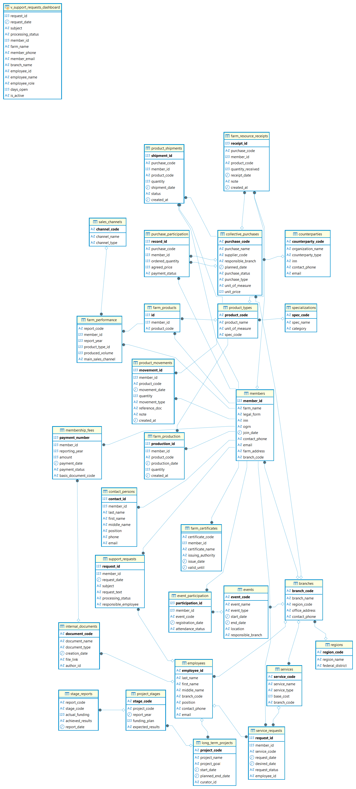

# Информационная система «Ассоциация фермерских хозяйств» (Архитектура БД и Data Engineering)


## 📌 Обзор проекта
Данный проект представляет собой комплексную реляционную базу данных и бэкенд-систему для автоматизации учёта деятельности **Ассоциации фермерских хозяйств (АФХ)**. Система централизует данные о членах ассоциации, производстве, совместных закупках, финансовых взносах и SLA-обращениях в службу поддержки.

**С точки зрения Data Engineering**, проект фокусируется на надежном моделировании данных, автоматической валидации качества данных (Data Quality), серверной автоматизации бизнес-процессов (ETL-подобная логика состояний), создании аналитических витрин (Views) и строгом управлении доступом и защитой персональных данных (Data Governance / PII).

## 🚀 Ключевые инженерные достижения

### 1. Моделирование данных и миграция
* Спроектирована нормализованная реляционная схема (**28 таблиц**, 3НФ), охватывающая сложные бизнес-сущности и связи (Many-to-Many).
* Успешно выполнена **миграция данных с MySQL на PostgreSQL**: адаптированы типы данных, настроены последовательности (`GENERATED ... AS IDENTITY` / `nextval`) и обеспечена строгая ссылочная целостность.

### 2. Качество данных и автоматическая валидация (Data Quality)
Реализованы серверные проверки для предотвращения попадания некорректных данных (принцип "Garbage In, Garbage Out"), гарантирующие целостность независимо от клиентского приложения:
```sql
-- Блокировка ввода отрицательных или нулевых объемов на уровне СУБД
CREATE OR REPLACE FUNCTION fn_validate_positive_quantity() RETURNS TRIGGER AS $$
BEGIN
    IF NEW.quantity <= 0 THEN
        RAISE EXCEPTION 'Количество должно быть строго больше нуля. Получено: %', NEW.quantity;
    END IF;
    RETURN NEW;
END;
$$ LANGUAGE plpgsql;
```

### 3. Серверная автоматизация состояний (State Machine)
Жизненный цикл совместных закупок автоматизирован с помощью триггеров. База данных самостоятельно пересчитывает статус закупки на основе фактов отгрузки и приёмки, снимая эту нагрузку с приложения:
* `planned` ➔ `in_transit` (при регистрации отгрузок)
* `in_transit` ➔ `delivered` (при факте приёмки ресурсов)

### 4. Аналитические витрины данных (Data Marts)
Создан слой денормализованных представлений (Views), который скрывает сложность `JOIN`-ов и агрегаций, предоставляя готовый семантический слой для аналитики и дашбордов:
* **`v_support_sla_breaches`**: Мониторинг обращений, по которым нарушены нормативы SLA (реакция > 3 дней, решение > 7 дней).
* **`v_collective_purchase_status`**: Агрегация плановых, отгруженных и фактически принятых объемов по каждой закупке.

### 5. Управление данными и безопасность (Data Governance & PII)
Реализованы меры защиты, соответствующие принципам работы с конфиденциальной информацией:
* **RBAC (Ролевая модель доступа)**: 4 изолированные роли (`accountant`, `support`, `member`, `purchase_manager`) с тонкой настройкой прав, включая column-level privileges (например, бухгалтер может менять статус оплаты, но не может изменить сумму взноса).
* **Защита PII (Персональных данных)**: Конфиденциальные поля (ИНН, ОГРН, телефоны, email) автоматически хешируются с использованием расширения **`pgcrypto`** (SHA-256 + криптографическая соль) перед `INSERT`/`UPDATE`.
```sql
-- Автоматическое хеширование PII-данных при вставке/обновлении
CREATE OR REPLACE FUNCTION fn_hash_member_data() RETURNS TRIGGER AS $$
BEGIN
    NEW.inn           := encode(digest(NEW.inn, 'sha256'), 'hex');
    NEW.contact_phone := encode(digest(NEW.contact_phone, 'sha256'), 'hex');
    -- ...
    RETURN NEW;
END;
$$ LANGUAGE plpgsql;
```

## 🛠 Технологический стек
* **СУБД**: PostgreSQL 17, PL/pgSQL
* **Безопасность**: `pgcrypto` (SHA-256), Row/Column-level RBAC
* **Бэкенд**: Python 3.10+, Bottle Framework, `psycopg2` (параметризованные запросы для защиты от SQL-инъекций)
* **Инструменты**: DBeaver (проектирование схемы и миграция)

## 🗄 Схема базы данных (ER-диаграмма)
*(Здесь будет скриншот из DBeaver)*

> *Схема поддерживает сложные связи, такие как участие фермеров в множественных закупках, и отслеживает полный жизненный цикл движения продукции.*

## 📂 Структура репозитория
```text
├── sql/
│   ├── 01_schema.sql       # DDL: Таблицы, PK, FK, CHECK-ограничения
│   ├── 02_views.sql        # Аналитические витрины (Data Marts)
│   ├── 03_procedures.sql   # Атомарные бизнес-транзакции
│   ├── 04_triggers.sql     # Валидация данных и автоматизация состояний
│   └── 05_security.sql     # RBAC, функции хеширования pgcrypto
└── app/                    # Веб-интерфейс на Python (Bottle)
```


## 🎓 Статус проекта
Проект разработан в рамках выпускной курсовой работы по специальности **09.02.07 «Информационные системы и программирование»** (ГУАП) и **защищен на оценку «5» (Отлично)**. 
Работа демонстрирует практические навыки проектирования архитектуры БД, серверного программирования и обеспечения безопасности данных.
